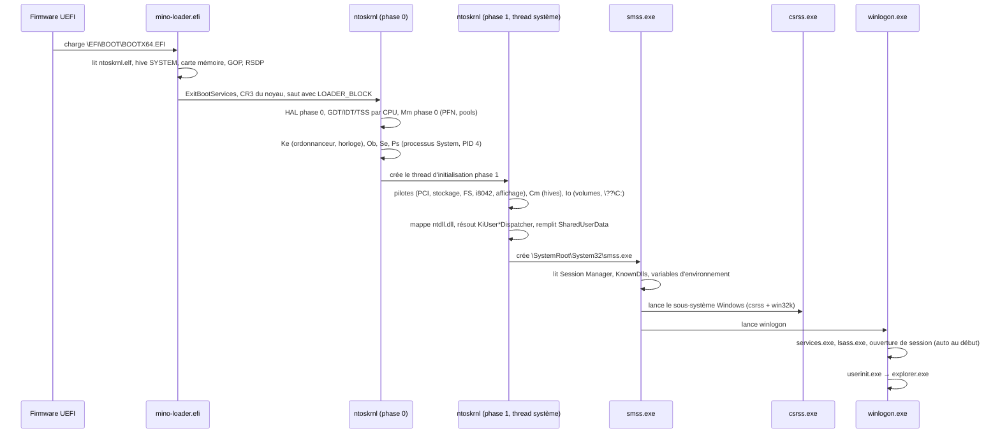

# 02 — Architecture

Ce document décrit l'architecture **cible** de Mino. L'état actuel du code et ce qu'on en garde sont décrits dans [04 — Audit et réutilisation](04-audit-reutilisation.md). Les justifications des choix se trouvent dans [03 — Décisions](03-decisions.md), et les numéros `ADR-xxx` y renvoient.

---

## 1. Vue d'ensemble

```
┌──────────────────────────────────────────────────────────────────────────┐
│ Applications PE32 i386 : explorer, notepad, jeux D3D8/9, installeurs     │
├──────────────────────────────────────────────────────────────────────────┤
│ DLL Win32 (ReactOS/Wine, épinglées)                                      │
│ kernel32 advapi32 user32 gdi32 shell32 comctl32 ole32 msvcrt ws2_32 …    │
│ d3d8/d3d9/ddraw → wined3d → opengl32 (Mesa, rendu logiciel)              │
├─────────────────────────────────────┬────────────────────────────────────┤
│ ntdll.dll (ReactOS)                 │ Processus système (ReactOS)        │
│ Ldr, Rtl, Csr, KiUser*Dispatcher    │ smss csrss winlogon services lsass │
├═════════════════════════════════════╧════════════════════════════════════┤  ← ring 3 / ring 0
│ Portes : int 2Ah–2Eh, SYSENTER (Intel)        tables de services NT+Win32│
├──────────────────────────────────────────────────────────────────────────┤
│ win32k (Rust) : USER (fenêtres, messages, entrées) · GDI · polices       │
│                 pilote d'affichage interne                               │
├──────────────────────────────────────────────────────────────────────────┤
│ Exécutif NT (Rust)                                                       │
│ Ob · Ps · Mm · Io · Cm · Se · Lpc · Ex · Rtl                             │
├──────────────────────────────────────────────────────────────────────────┤
│ Ke (Rust) : dispatcher, ordonnanceur, IRQL, APC, DPC, timers, exceptions │
├──────────────────────────────────────────────────────────────────────────┤
│ HAL (Rust) : CPU, APIC/IOAPIC, ACPI, PCI, horloges, ports, framebuffer   │
├──────────────────────────────────────────────────────────────────────────┤
│ Pilotes (Rust, liés statiquement) : stockage, FS, entrée, vidéo, réseau… │
├──────────────────────────────────────────────────────────────────────────┤
│ Chargeur UEFI (Rust) → ntoskrnl ELF64                                    │
└──────────────────────────────────────────────────────────────────────────┘
```

### Ce qui est écrit, ce qui est réutilisé

| Couche | Provenance | Langage | Contrat qui la lie au reste |
|---|---|---|---|
| Chargeur UEFI, HAL, Ke, exécutif, pilotes, win32k | **Mino** | Rust `no_std` | Interfaces internes Rust |
| `ntdll` et tout l'espace utilisateur | **ReactOS, version épinglée** (ADR-002) | C | Tables d'appels système, structures en mode utilisateur, ports LPC, interface win32k |
| Pile Direct3D | Wine (via ReactOS) et Mesa | C/C++ | API Win32 et GDI seulement : ces composants n'ont aucune dépendance directe au noyau |
| Remplacements ultérieurs | Mino | Rust (cible `i686-pc-windows-*`) | Les mêmes exports que la DLL remplacée |

**Règle structurante : la frontière stable du projet est l'interface noyau de ReactOS.** On entend par là les numéros et signatures des appels système de `ntoskrnl` et `win32k`, les structures en mode utilisateur et les protocoles LPC de CSR. Tant que le noyau Mino respecte ce contrat, n'importe quel binaire utilisateur de la version épinglée fonctionne.

---

## 2. Modèle CPU (ADR-001)

| Élément | Choix |
|---|---|
| Noyau | x86-64 en long mode, lié dans les 2 Gio supérieurs (`0xFFFFFFFF80000000`, `code-model=kernel`), format ELF64 |
| Mode utilisateur | **i386 natif en mode compatibilité** : segments 32 bits (L=0, D=1), pas de couche WoW64 |
| ABI vue par les processus | Celle de Windows XP x86 : PEB32, TEB32, `KUSER_SHARED_DATA`, trames d'exception x86, SEH chaîné via `FS:[0]` |
| Multiprocesseur | Conçu pour le SMP dès le départ (structures par CPU, verrous avec IRQL), mais un seul CPU actif jusqu'au jalon M10 |
| FPU, SSE | Sauvegarde complète (`FXSAVE`, puis `XSAVE` si disponible) à chaque changement de contexte de thread utilisateur, sans commutation paresseuse (ADR-009) |

Ce modèle diffère de Windows : un XP x86 tourne sur un noyau 32 bits, et un XP x64 exécute le 32 bits via WoW64. Mino expose une ABI 32 bits **native**, servie directement par un noyau 64 bits. Le noyau traduit donc lui-même les trames, les contextes et les structures entre leur forme 32 bits utilisateur et leur forme 64 bits interne. Ça ne pose problème qu'aux pilotes binaires d'XP, déjà hors périmètre.

---

## 3. Séquence de démarrage



### Bloc de démarrage (`LOADER_BLOCK`)

C'est une structure `#[repr(C)]` versionnée, définie dans la crate `abi`. Elle contient :

- la carte mémoire UEFI normalisée ;
- les plages physiques réservées (noyau, hive, ramdisk éventuel) ;
- le framebuffer GOP (base, taille, pitch, format) ;
- le RSDP ACPI ;
- la ligne de commande du noyau (`/DEBUGPORT=COM1 /BREAK /SOS`, etc.) ;
- l'adresse physique et la taille du hive `SYSTEM` préchargé ;
- l'offset du mapping direct de la mémoire physique (HHDM).

Le chargeur ne charge **que** le noyau et le hive `SYSTEM`. Les pilotes sont liés statiquement au noyau (ADR-008). `ntdll` et tout le reste sont lus plus tard par le noyau, à travers sa propre pile d'E/S.

---

## 4. Espaces d'adresses

### 4.1 Processus (vue 32 bits)

| Plage | Contenu |
|---|---|
| `0x00000000–0x0000FFFF` | Interdite (piège à pointeurs nuls) |
| `0x00010000–…` | Image `.exe` (base usuelle `0x00400000`), tas, piles, vues mappées |
| `…–0x7FFDxxxx` | DLL, en haut de l'espace ; adresses préférées respectées si libres |
| `0x7FFDE000` | TEB du premier thread (les suivants en dessous) |
| `0x7FFDF000` | PEB (adresse fixe d'XP SP0/SP1 ; Mino ne la randomise pas) |
| `0x7FFE0000` | `KUSER_SHARED_DATA`, en lecture seule (le noyau l'écrit via son propre alias) |
| `0x7FFF0000–0x7FFFFFFF` | Zone de garde |
| `0x80000000–0xFFFFFFFF` | Réservée par défaut. Accessible aux images `LARGE_ADDRESS_AWARE`, comme sous WoW64 : le noyau étant en 64 bits, aucun « /3GB » n'est nécessaire |

### 4.2 Noyau (x86-64)

| Plage (indicative) | Contenu |
|---|---|
| `0x0000_0000_0000_0000–0x0000_0000_FFFF_FFFF` | Espace utilisateur 32 bits du processus courant, propre à chaque PML4 |
| `0xFFFF_8000_0000_0000` | Mapping direct de toute la mémoire physique (HHDM) |
| `0xFFFF_8800_0000_0000` | Pools : non paginé puis paginé (ADR-010) |
| `0xFFFF_9000_0000_0000` | Base de données PFN |
| `0xFFFF_A000_0000_0000` | Espace de session : tas de bureau de win32k, surfaces GDI |
| `0xFFFF_B000_0000_0000` | Piles noyau, chacune avec une page de garde non mappée |
| `0xFFFF_C000_0000_0000` | Vues système (sections mappées dans le noyau), hyperspace |
| `0xFFFF_FFFF_8000_0000` | Image `ntoskrnl` (`.text` en RX, `.rodata` en R, `.data` et `.bss` en RW+NX) |

Points d'invariance :

- **La moitié haute est partagée** : chaque PML4 de processus recopie les entrées 256 à 511 de la PML4 système, complétées dès le démarrage (une PDPT chacune) pour ne plus changer ensuite.
- **Aucun mapping identité** ne survit à la phase 0.
- **Le noyau n'accède jamais directement à la mémoire utilisateur** : il passe par les primitives de sonde et de copie décrites au §6.4.

---

## 5. Le noyau, composant par composant

Chaque composant est une crate dont l'API publique est minimale. Les dépendances suivent l'ordre NT : `hal` ← `ke` ← `mm`/`ob` ← `ps`/`io`/`cm`/`se`/`lpc`/`ex` ← `win32k`. Un composant ne lit jamais les structures internes d'un autre.

### 5.1 HAL (`kernel/hal`)

- **Processeur** : GDT et TSS par CPU, IDT, MSR, CPUID, `FXSAVE`/`XSAVE`, `SWAPGS` et zone par CPU (`KPCR`/`KPRCB`) accessible via `GS`.
- **Interruptions** : APIC local, IOAPIC, routage ACPI (tables MADT, puis `_PRT` si nécessaire), objets d'interruption (`KINTERRUPT`) et association vecteur → IRQL.
- **Horloges** : APIC timer calibré (PIT ou HPET), TSC. L'interruption d'horloge appelle `KeUpdateSystemTime`, `KeUpdateRunTime` et la mise à jour de `KUSER_SHARED_DATA`.
- **Accès matériels** : ports d'E/S, espace de configuration PCI (CF8/CFC puis ECAM), MMIO non cacheable.
- **Console de démarrage** : sortie série (COM1) et texte sur le framebuffer GOP pour l'écran de démarrage « /SOS » et l'écran d'erreur fatale.

### 5.2 Ke — noyau (`kernel/ke`)

- **Dispatcher** : un `DISPATCHER_HEADER` commun à tous les objets attendables (événements, mutants, sémaphores, timers, threads, processus, files d'attente), avec `KWAIT_BLOCK`, `KiWaitTest` et la consommation de l'objet par le signaleur. Le point de départ est `dispatcher.rs` (ADR-005).
- **Ordonnanceur** : 32 niveaux de priorité, priorités dynamiques et boosts (fin d'E/S, premier plan, famine), quantum, file des threads prêts par CPU et `KiSwapThread`.
- **IRQL** : `PASSIVE`, `APC`, `DISPATCH`, `DIRQL`, `HIGH`, implémentés via le TPR de l'APIC.
- **APC** : noyau spéciaux, noyau normaux et utilisateur. Les APC utilisateur sont livrées au retour vers le mode utilisateur via `ntdll!KiUserApcDispatcher`.
- **DPC** : une file par CPU, vidée à la descente sous `DISPATCH_LEVEL`. Elle n'alloue jamais.
- **Timers** : roue de timers, `KTIMER` périodiques, résolution réglable (`NtSetTimerResolution`, `timeBeginPeriod(1)`).
- **Exceptions** : trames de trap, `KiDispatchException` vers les gestionnaires noyau ou vers `ntdll!KiUserExceptionDispatcher`, et écran d'erreur fatale (`KeBugCheckEx`).
- **Callbacks vers le mode utilisateur** : `KeUserModeCallback`, avec une pile noyau chaînée par callback et un retour via `int 2Bh` (`NtCallbackReturn`). Ils sont indispensables à win32k pour appeler les procédures de fenêtre (WndProc).

### 5.3 Mm — gestionnaire de mémoire (`kernel/mm`)

- **Mémoire physique** : allocateur buddy (déjà en place) et base de données PFN (état, compteur de références, page de liste).
- **Pools** : allocateur à dalles par taille pour le pool non paginé et le pool paginé. Tant qu'il n'y a pas de fichier d'échange, le pool paginé ne sort jamais de la mémoire (ADR-010).
- **VAD** : un arbre par processus, avec les états réservé, commité et libéré, les protections, et les types privé, mappé ou image.
- **Fautes de page** : résolution à la demande (page à zéro, page de section, copie sur écriture), pages de garde (`STATUS_GUARD_PAGE_VIOLATION`, croissance de pile) et accès invalides transformés en exceptions.
- **Sections** : sections adossées au fichier d'échange (mémoire partagée), sections de fichier de données et **sections d'image** PE. Ces dernières utilisent la crate `pe`, gèrent la copie sur écriture, et servent à `ntdll`, au chargeur de ntdll et à `NtMapViewOfSection`. Comme sur XP, une image projetée hors de sa base rend `STATUS_IMAGE_NOT_AT_BASE` et c'est `ntdll` qui la reloge, sur des pages qui se copient à l'écriture : le noyau ne reloge pas (sinon le décalage s'appliquerait deux fois).
- **Espaces d'adresses** : une PML4 par processus, l'attachement à un autre processus (`KeStackAttachProcess`) et l'hyperspace.
- **DEP** (ADR-020) : règle OptIn d'XP SP2. Sans DEP, toute page utilisateur lisible s'exécute ; avec DEP, seules les protections `PAGE_EXECUTE*`. La VAD garde la protection demandée.
- **Plus tard** : fichier d'échange et working sets réduits.

### 5.4 Ob — gestionnaire d'objets (`kernel/ob`)

- **En-tête d'objet** : comptes de pointeurs et de handles, type, nom, descripteur de sécurité.
- **Types** : `Type`, `Directory`, `SymbolicLink`, `Process`, `Thread`, `Event`, `Mutant`, `Semaphore`, `Timer`, `Section`, `File`, `Key`, `Port`, `Token`, `WindowStation`, `Desktop`, etc.
- **Espace de noms** : `\`, `\Device`, `\Driver`, `\??` (avec les lettres de lecteur), `\BaseNamedObjects`, `\KnownDlls`, `\Windows`, `\Sessions`, `\RPC Control`. L'analyse des noms est déléguée à la procédure *parse* du type concerné (fichiers vers Io, clés vers Cm).
- **Tables de handles** : une par processus. Un handle est un multiple de 4, avec un masque d'accès et un drapeau d'héritage, et sa duplication passe par `NtDuplicateObject`.

### 5.5 Ps — processus et threads (`kernel/ps`)

- `EPROCESS` et `ETHREAD` sont des structures Rust internes, sans contrainte de layout. Seuls le PEB32 et le TEB32 suivent le format XP au bit près (crate `abi`).
- **Identifiants** : PID et TID viennent d'une même table (PspCidTable), en multiples de 4 ; System a le PID 4.
- **Fin** : `NtTerminateProcess` et `NtTerminateThread` passent par un APC noyau dans chaque thread visé, qui se termine dans son propre contexte. Le dernier thread d'un processus ferme ses handles et rend son espace d'adresses, une fois finis les accès en cours (protection de *rundown*), puis signale l'objet processus. Un *reaper* rend la pile noyau des threads terminés, une fois qu'ils ont quitté le processeur.
- **Appels système** : `NtCreateProcess(Ex)`, `NtCreateThread`, `NtTerminateProcess` et `NtTerminateThread`, avec le *rundown* (fermeture des handles, abandon des mutants), ainsi que `NtQueryInformationProcess/Thread`, `NtSetInformation*`, `NtSuspendThread`/`NtResumeThread` et `NtGetContextThread`/`NtSetContextThread`.
- **Processus initial** : `smss.exe` est créé directement par le noyau, au moyen d'un équivalent de `RtlCreateUserProcess` en mode noyau.
- **Notifications** : messages au processus CSR (création et fin de processus et de threads) et ports d'exception et de débogage (plus tard).

### 5.6 Io — gestionnaire d'E/S (`kernel/io`)

- **Modèle** : objets pilote et périphérique, piles de périphériques, IRP avec emplacements de pile, routines de complétion, `IoCallDriver` et `IoCompleteRequest`.
- **Fichiers** : `FILE_OBJECT`, I/O synchrones et asynchrones, complétion par événement ou par APC, ports de complétion (`NtCreateIoCompletion`) et notifications de changement de répertoire.
- **Énumération** : statique au démarrage. On parcourt le PCI et les tables ACPI, puis on associe chaque périphérique à son pilote via une table interne. Le Plug and Play complet est remis à plus tard.
- **Volumes** : gestionnaire de partitions (MBR et GPT), montage des systèmes de fichiers et liens `\??\C:` → `\Device\HarddiskVolumeN`.

### 5.7 Cm — registre (`kernel/cm`)

- **Format** : ruches au format `regf`, compatibles avec les outils existants. Le chargeur fournit `SYSTEM`. `SOFTWARE`, `DEFAULT`, `SAM`, `SECURITY` et les `NTUSER.DAT` sont chargés en phase 1.
- **Objets** : les clés sont des objets Ob. On fournit `NtCreateKey`, `NtOpenKey`, `NtQueryValueKey`, `NtEnumerateKey`, `NtSetValueKey`, `NtDeleteKey`, `NtFlushKey` et `NtNotifyChangeKey`.
- **Persistance** : écriture différée des ruches modifiées (*lazy flush*) et fichier `.LOG` en option.
- **Génération** : les ruches initiales sont produites par l'outil hôte `mkhive` à partir des fichiers `.inf` de ReactOS (ADR-012).

### 5.8 Se — sécurité (`kernel/se`)

- Jetons, SID, privilèges, descripteurs de sécurité et ACL.
- `SeAccessCheck` est implémenté **dès le départ**, avec un mode « permissif » activé au début qui journalise les refus sans les appliquer (ADR-011).
- Une session par défaut, celle d'un administrateur. `lsass.exe` (ReactOS) dialogue avec le noyau via LPC.

### 5.9 Lpc — ports (`kernel/lpc`)

- C'est le LPC d'XP (et non l'ALPC de Vista) : `NtCreatePort`, `NtConnectPort`/`NtSecureConnectPort`, `NtAcceptConnectPort`, `NtCompleteConnectPort`, `NtRequestWaitReplyPort`, `NtReplyWaitReceivePort(Ex)`, `NtReplyPort`, et les messages volumineux via sections partagées.
- Il est indispensable à CSR (`csrss`), à `lsass`, aux services et à SMSS.

### 5.10 Ex et Rtl (`kernel/ex`, `kernel/rtl`)

- **Objets exécutifs** : événements, mutants, sémaphores, timers, événements à clé (*keyed events*), paires d'événements.
- **Synchronisation interne** : `ERESOURCE`, mutex rapides et *pushlocks*.
- **Divers** : threads de travail, listes *lookaside*, informations système (`NtQuerySystemInformation`), heure et fuseau, UUID, génération de LUID.
- **Rtl noyau** : chaînes Unicode, bitmaps, arbres AVL, conversions de chemins. Ces fonctions sont aussi partagées avec les outils hôte quand c'est possible.

### 5.11 Diagnostic (`kernel/kd`)

- `DbgPrint` et `int 2Dh` (le service de débogage appelé par `ntdll`) sont redirigés vers COM1 avec un préfixe processus/thread. Les versions *debug* des DLL ReactOS écrivent leurs `DPRINT` par ce canal.
- Écran d'erreur fatale avec code et paramètres, pile noyau symbolisée : la chaîne des RBP (noyau compilé avec les pointeurs de cadre), nommée par la table des symboles de l'ELF du noyau, que le chargeur lui transmet.
- Débogage au niveau source via le *gdbstub* de QEMU (`-s -S`) et un fichier ELF avec ses symboles. Le protocole KD de Windows n'est pas prévu.

---

## 6. La frontière entre mode utilisateur et noyau

### 6.1 Portes d'interruption

| Vecteur | DPL | Rôle (convention XP) |
|---|---|---|
| `2Ah` | 3 | `KiGetTickCount` |
| `2Bh` | 3 | `KiCallbackReturn` (retour d'un `KeUserModeCallback`) |
| `2Ch` | 3 | `KiRaiseAssertion` |
| `2Dh` | 3 | `KiDebugService` (`DbgPrint`, points d'arrêt de débogage) |
| `2Eh` | 3 | `KiSystemService`, appel système de repli |
| `SYSENTER` | — | Appel système rapide, **sur Intel uniquement** |

Les portes `2Ah` à `2Eh` empilent toutes la même trame (`hal::trap`), et le noyau branche un handler par vecteur (`kernel/ntoskrnl/src/sys/gates.rs`). Tant que `KeUserModeCallback` n'existe pas, `2Bh` rend `STATUS_NO_CALLBACK_ACTIVE`. `2Ch` lève `STATUS_ASSERTION_FAILURE` à l'adresse de l'instruction (§6.5). `2Dh` saute l'`int 3` qui la suit dans `ntdll`.

**Sélection du chemin rapide (ADR-004)** : SYSENTER n'existe pas en long mode sur AMD, et SYSCALL depuis le mode compatibilité n'existe pas sur Intel ([OSDev](https://wiki.osdev.org/SYSENTER), commentaires de `arch/x86/entry/entry_64_compat.S` dans Linux). Le noyau lit donc CPUID au démarrage et écrit dans `SharedUserData->SystemCall` (offset `0x300`) l'adresse de `ntdll!KiFastSystemCall` sur Intel, ou celle de `ntdll!KiIntSystemCall` (`int 2Eh`) sur les autres processeurs. C'est le mécanisme qu'utilisait XP SP2, et les stubs de `ntdll` passent par ce pointeur. Écart provisoire : tant que SYSENTER ne revient pas par `ntdll` pour les processus de Ps, ce pointeur désigne `KiIntSystemCall` sur tous les processeurs (`ps::system_dll`).

### 6.2 Tables de services

- **Deux tables** : `KiServiceTable` pour `ntoskrnl` (numéros `0x0000–0x0FFF`) et `W32pServiceTable` pour `win32k` (`0x1000–0x1FFF`).
- **Une seule source de vérité** : l'outil `tools/syscall-gen` lit les listes de services de la version épinglée de ReactOS, copiées avec leur origine dans `tools/syscall-gen/reactos/<version>/` (`sysfuncs.lst`, `w32ksvc32.h`, variante i386 de publication). Il génère :
  - les tables Rust (numéro, nombre d'octets d'arguments, pointeur de handler) ;
  - des handlers par défaut qui renvoient `STATUS_NOT_IMPLEMENTED` **et le journalisent** ;
  - un rapport de couverture (nombre d'appels implémentés sur le total).
- **Aucun numéro écrit à la main**, ni aucun appel système privé : les anciens `0x2000+` disparaissent.
- **Dispatcher** : `kernel/ntoskrnl/src/sys/` associe à chaque service implémenté son handler (liste `IMPLEMENTED`, d'où vient le rapport de couverture `docs/compat/syscalls.md`). Les tables générées sont dans `abi/src/services.rs`.

### 6.3 Trame de trap et pile noyau

- **Piles** : chaque thread a sa pile noyau de 24 Kio, encadrée d'une page de garde. `TSS.RSP0` et `SYSENTER_ESP` (par CPU) pointent vers la pile du thread courant.
- **Trame** : la trame unique `KTRAP_FRAME` (format 64 bits interne, `hal::trap::KTrapFrame`) sauvegarde tous les registres généraux, les segments et la trame `IRET`. Elle sait se convertir en `CONTEXT` x86 (format 32 bits, `abi::context`) pour les exceptions, `NtGetContextThread` et les APC (`ke::context`). Un contexte venu du mode utilisateur est assaini : EFLAGS ne garde que les drapeaux du mode utilisateur, et les sélecteurs sont imposés.
- **Interruptions** : chaque appel système réactive les interruptions et s'exécute à `PASSIVE_LEVEL`. Il peut donc bloquer, être préempté et subir une faute de page.
- **Segment `FS`** : à chaque changement de contexte, le noyau met à jour la base du descripteur TEB de la GDT du CPU puis recharge `FS`, comme `KiSwapContext` le faisait sous XP.

### 6.4 Accès à la mémoire utilisateur

- **Primitives uniques** : `probe_for_read`, `probe_for_write`, `copy_from_user`, `copy_to_user` et `UserPtr<T>`, regroupées dans `kernel/ke/src/usermem.rs`. Elles copient par `hal::usermem`, qui tient la routine de copie et la table de correction.
- **Récupération des fautes** : chaque instruction susceptible de fauter est enregistrée dans une table de correspondance (`__ex_table`). Si la faute est irrécupérable, le gestionnaire de faute de page reprend l'exécution à l'adresse de correction, et l'appel système renvoie `STATUS_ACCESS_VIOLATION` au lieu de faire paniquer le noyau.
- **Interdit** : déréférencer un pointeur utilisateur hors de ces primitives. Une règle de lint et la revue de code y veillent.

### 6.5 Livraison vers le mode utilisateur

| Événement | Point d'entrée dans `ntdll` (exporté, résolu par le noyau au chargement de ntdll) |
|---|---|
| Exception | `KiUserExceptionDispatcher(EXCEPTION_RECORD*, CONTEXT*)` |
| APC utilisateur | `KiUserApcDispatcher` |
| Callback de win32k | `KiUserCallbackDispatcher(index, args, len)` |
| Démarrage d'un thread | `LdrInitializeThunk` (contexte initial pointant vers `BaseProcessStartThunk` ou `BaseThreadStartThunk`) |

**ntdll et `KUSER_SHARED_DATA`** (`ps::system_dll`, `mm::shared_data`, `kernel/ntoskrnl/src/shared_data.rs`) :

- **`KUSER_SHARED_DATA`** (`abi::shared_data`, disposition d'XP SP2) : une page que le noyau remplit au démarrage, avec la version 5.1, la racine `C:\WINDOWS`, les fonctions du processeur, les pages physiques, la politique DEP et le cookie. L'horloge y écrit ses temps par l'alias du noyau. Chaque processus la projette en lecture seule en `0x7FFE0000`.
- **DLL système** : le noyau résout les points d'entrée de `ntdll` à son installation : les répartiteurs, `LdrInitializeThunk`, `KiIntSystemCall` et `KiFastSystemCallRet` (`SystemCall`, `SystemCallReturn`). Une entrée manquante rend `STATUS_PROCEDURE_NOT_FOUND`. Chaque processus créé ensuite projette `ntdll` à sa base.
- **Démarrage d'un thread** : comme `PspUserThreadStartup`, le noyau met sur la pile du thread son contexte initial, puis l'APC utilisateur `LdrInitializeThunk(NULL, base de ntdll, NULL)`. Le thread entre dans `KiUserApcDispatcher`, qui reprend le contexte par `NtContinue`.
- **Réserve** : sous chaque `CONTEXT` d'APC, le noyau laisse 8 octets sous l'ESP interrompu. Le `KiUserApcDispatcher` de ReactOS y écrit son enregistrement SEH.
- **Pas encore** : le fichier `ntdll.dll` lui-même (`cargo xtask fetch-userland`), puis son installation au démarrage.

**Exceptions** (`ke::exception`, `kernel/ntoskrnl/src/sys/exceptions.rs`) :

- **Entrée** : #DE, #BP, #UD, #GP et #PF venus du mode utilisateur empilent la trame de trap (`hal::trap`) ; venus du noyau, ils gardent leurs handlers (`hal::idt`).
- **Codes** :
  - #DE : `STATUS_INTEGER_DIVIDE_BY_ZERO` ;
  - #BP : `STATUS_BREAKPOINT`, EIP ramené sur l'`int 3` ;
  - #UD : `STATUS_ILLEGAL_INSTRUCTION` ;
  - #GP : `STATUS_PRIVILEGED_INSTRUCTION` pour une instruction privilégiée, `STATUS_ACCESS_VIOLATION` sinon ;
  - #PF : l'exception que rend Mm.
- **KiDispatchException** : le noyau met sur la pile du thread son `CONTEXT`, l'`EXCEPTION_RECORD` et leurs deux adresses, puis le thread reprend dans `KiUserExceptionDispatcher`. Celui-ci appelle `NtContinue` pour reprendre, ou `NtRaiseException` en seconde chance.
- **Fin du processus** : il n'y a ni débogueur ni port d'exception. Le processus se termine avec le code de l'exception dans trois cas : une seconde chance, l'absence de répartiteur (tant que `ntdll` n'est pas projeté), ou une pile qui ne reçoit pas le contexte.
- **Pas encore** :
  - les exceptions flottantes, qui terminent le processus ;
  - #DB, #OF, #BR, #NP, #SS et #AC en mode utilisateur ;
  - `STATUS_INTEGER_OVERFLOW` pour un quotient trop grand.

**APC utilisateur** (`ke::apc`, `kernel/ntoskrnl/src/sys/apc.rs`) :

- **File** : un APC utilisateur (NtQueueApcThread) attend que son thread fasse une attente alertable en mode utilisateur, ou appelle NtTestAlert. Une telle attente rend `STATUS_USER_APC`, aussitôt si un APC est en file, sinon à son insertion. Une attente non alertable le laisse en file.
- **Livraison** : au retour en mode utilisateur par la trame de trap (`hal::trap::set_user_return_hook`), sa routine noyau s'exécute à `APC_LEVEL`. Le noyau met sur la pile le `CONTEXT`, puis la routine, son contexte et ses deux arguments, et le thread reprend dans `KiUserApcDispatcher`. Celui-ci appelle la routine puis `NtContinue(context, TRUE)`, dont le test d'alerte livre l'APC suivant.
- **Pas encore** :
  - les alertes (NtAlertThread, `STATUS_ALERTED`) ;
  - la livraison après SYSENTER, qui n'a pas de trame ;
  - les attentes sur objets (`NtWaitForSingleObject`…).

---

## 7. Le sous-système Win32

### 7.1 Répartition des rôles

| Composant | Provenance | Rôle |
|---|---|---|
| `csrss.exe` (`csrsrv`, `basesrv`, `winsrv`, `consrv`) | ReactOS | Serveur du sous-système : enregistrement des processus, consoles, arrêt du système |
| `win32k` | **Mino, Rust** | Fenêtres, messages, entrées, GDI, polices, pilote d'affichage |
| `user32`, `gdi32`, `imm32`… | ReactOS | Côté client. Appellent `NtUser*` et `NtGdi*` et lisent des objets partagés en lecture seule |

### 7.2 win32k

- **USER** :
  - stations de fenêtres et bureaux, fenêtres et classes ;
  - une file de messages par thread, avec envoi synchrone (`SendMessage`, y compris entre threads) et asynchrone (`PostMessage`) ;
  - thread d'entrée brute (lecture clavier et souris par IRP), focus et activation ;
  - crochets (*hooks*), timers, carets, curseurs, menus et presse-papiers.
- **GDI** :
  - contextes de périphérique, surfaces DIB, pinceaux, stylos, régions, palettes et transformations ;
  - un **moteur DIB en Rust** (BitBlt, StretchBlt, ROP, motifs, alpha, lignes et courbes) qui joue le rôle de la bibliothèque `Eng*` de Windows ;
  - texte via un rastériseur TrueType en Rust `no_std` (ADR-013).
- **Pilote d'affichage** : un trait Rust interne (`DisplayDriver`), implémenté par `gopfb` (framebuffer UEFI fixe), puis `bochs-dispi` (QEMU, VirtualBox VBoxVGA) pour changer de mode, puis `vmsvga`.
- **Objets partagés** : les tables de handles USER, le tas de bureau et les informations partagées (`SHAREDINFO`) sont mappés **en lecture seule** dans chaque processus GUI. Les structures concernées (`WND`, `CLS`, `HANDLEENTRY`…) suivent **les en-têtes de la version épinglée de ReactOS** (ADR-002, à valider par le spike S3).

### 7.3 Graphisme 3D et multimédia (ADR-006)

```
jeu D3D8/D3D9/DirectDraw
   → d3d8.dll / d3d9.dll / ddraw.dll (Wine, via ReactOS)
   → wined3d (Wine 10, en mode utilisateur)
   → opengl32.dll (Mesa, rendu logiciel llvmpipe ou softpipe)
   → gdi32 : StretchDIBits / SetDIBitsToDevice
   → win32k (moteur DIB) → pilote d'affichage
```

- **Aucun code 3D dans le noyau.** La performance dépend du CPU, de la qualité du multithreading et de la vitesse des blits GDI.
- **Plus tard** : accélération matérielle via un pilote Gallium en mode utilisateur (`svga` ou `virgl`), plus un miniport noyau en Rust.
- **Son** : pilote HDA en Rust plus une interface pour `winmm` et `dsound`. Le modèle (*kernel streaming* comme ReactOS, ou interface simplifiée) fera l'objet d'une ADR à écrire au jalon M8.

---

## 8. Pilotes (ADR-008)

Les pilotes sont des crates Rust liées statiquement au noyau, qui implémentent le trait `Driver` (avec ses points d'entrée `DriverEntry`, `AddDevice` et `Dispatch[IRP_MJ_*]`). On n'en charge pas dynamiquement au début.

| Domaine | Ordre de réalisation |
|---|---|
| Stockage | ATA PIO (existant) → virtio-blk → AHCI → NVMe ; partitions MBR et GPT |
| Systèmes de fichiers | FAT32 en lecture et écriture (le volume système) → ISO9660 (médias d'installation) → NTFS en lecture seule → NTFS en lecture et écriture |
| Entrée | i8042 (clavier et souris PS/2), `kbdclass`, `mouclass` → USB xHCI et HID |
| Vidéo | `gopfb` → `bochs-dispi` → `vmsvga` |
| Série et debug | 16550 |
| Réseau (M9) | virtio-net, e1000 → pile TCP/IP en Rust → AFD ; `ws2_32` et `msafd` de ReactOS côté utilisateur |
| Son (M8) | HDA |
| Plateforme | ACPI (tables, arrêt via `_S5`), PCI, horloge temps réel (RTC) |

---

## 9. Image système et construction

### 9.1 Disque produit

```
GPT
├── ESP (FAT32, 64 Mio)
│   └── EFI\BOOT\BOOTX64.EFI          ← mino-loader
│   └── EFI\MINO\ntoskrnl.elf
└── Système (FAT32 → NTFS plus tard)  ← C:
    ├── WINDOWS\
    │   ├── system32\                 ← ntdll.dll, kernel32.dll, … (ReactOS), drivers\ (vide : pilotes intégrés)
    │   │   └── config\               ← SYSTEM SOFTWARE DEFAULT SAM SECURITY (générés par mkhive)
    │   ├── Fonts\                    ← polices libres
    │   └── …                         ← arborescence XP
    ├── Documents and Settings\
    └── Program Files\
```

### 9.2 Chaîne de construction (`cargo xtask`)

| Commande | Effet |
|---|---|
| `cargo xtask build` | Compile `mino-loader` (`x86_64-unknown-uefi`) et `ntoskrnl` (`x86_64-unknown-none`, ELF lié en haut de l'espace) |
| `cargo xtask fetch-userland` | Télécharge l'ISO ReactOS épinglée, **vérifie son SHA-256**, en extrait les binaires et les `.inf` dans `third_party/reactos/<version>/`. Le dossier est ignoré par Git. |
| `cargo xtask image` | `mkhive` + `mkimage` produisent `target/mino.img` (GPT, ESP, système) |
| `cargo xtask run [--gdb] [--smp N]` | Lance QEMU (OVMF, q35, sortie série sur stdio) |
| `cargo xtask test` | Tests hôte, puis tests de démarrage dans QEMU sans affichage (marqueurs série), puis sous-ensemble `rostests` |

Les scripts `tools/*.ps1` et `*.sh` actuels sont remplacés par `xtask`, en Rust, multiplateforme.

---

## 10. Organisation du dépôt cible

```
mini-nt-os/
├── abi/                 # #[repr(C)] partagés : LOADER_BLOCK, PEB32/TEB32, KUSER_SHARED_DATA,
│                        # CONTEXT x86, EXCEPTION_RECORD, NTSTATUS, tables générées
├── boot/loader/         # mino-loader (UEFI)
├── kernel/
│   ├── ntoskrnl/        # binaire : point d'entrée, phases d'init, assemblage des crates
│   ├── hal/  ke/  mm/  ob/  ps/  io/  cm/  se/  lpc/  ex/  rtl/  kd/
│   └── win32k/          # user/  gdi/  font/  display/
├── drivers/
│   ├── storage/{ata,virtio-blk,ahci,partmgr}
│   ├── fs/{fat,iso9660,ntfs}
│   ├── input/{i8042,kbdclass,mouclass}
│   ├── video/{gopfb,bochs-dispi}
│   └── misc/{serial,acpi,pci,rtc}
├── libs/
│   ├── pe/              # parseur PE32/PE32+ no_std (hôte + noyau)
│   └── regf/            # format de ruche (hôte + noyau)
├── userland/            # remplacements Rust de DLL (plus tard), cible i686-pc-windows-*
├── tools/
│   ├── syscall-gen/  mkhive/  mkimage/  pe-inspect/
├── xtask/
├── tests/
│   ├── host/            # tests d'intégration hôte
│   ├── boot/            # scénarios QEMU + marqueurs attendus
│   └── native/          # petits programmes PE de test (C, compilés avec MinGW)
├── third_party/         # (ignoré) binaires ReactOS épinglés, Mesa
└── docs/
```
