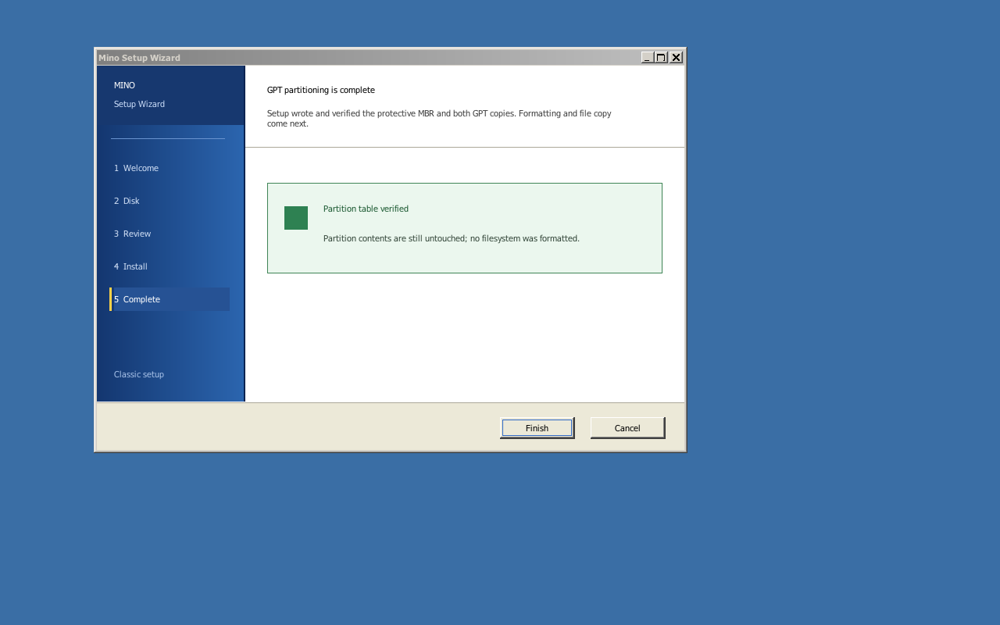

# Interface de l'installateur

État de l'interface native et de son moteur GPT initial, au-dessus du
constructeur d'image GPT/FAT décrit dans [`io-install.md`](io-install.md). Le
brief visuel reste
[`../design/installer-ui-prompt.md`](../design/installer-ui-prompt.md).



La présentation suit le langage visuel des assistants ReactOS et Windows XP :
rail bleu à cinq étapes, contenu blanc, barre d'actions beige et boutons en
relief. Les couleurs, le nom et les éléments graphiques restent propres à
Mino ; aucune ressource Microsoft n'est intégrée.

## Architecture retenue

L'installateur est un programme Win32 natif, lié aux `user32`, `gdi32`,
`kernel32` et `ntdll` de ReactOS épinglé. Il utilise donc les fenêtres, GDI,
les polices, les files de messages et l'entrée de `win32k` ; il n'introduit
pas une seconde boîte à outils qui dessinerait directement dans le
framebuffer.

`tests/native/setup1.c` est la sonde exécutable de ce choix. Le scénario
`installer-ui` la met à la place de `winlogon.exe`, comme les autres bancs
d'essai de USER. Elle ouvre une fenêtre à 760 × 520, qui tient dans un écran
de 800 × 600, et dessine ses contrôles avec GDI. C'est encore une sonde : le
programme définitif quittera `tests/native/` quand le chemin d'exécution du
moteur sera fixé.

## Aperçu et préparation GPT privilégiés

`NtDeviceIoControlFile`, avec `IOCTL_MINO_SETUP_QUERY`, donne à l'UI une
`abi::setup::SetupPreview` de 68 octets composée uniquement de mots 32 bits.
Elle contient la cible ATA, sa capacité, les deux plages de partitions et un
jeton stable calculé sur le plan. Cette première commande n'a aucun chemin
d'écriture.

`io_manager::install::Plan::guided` vérifie tout avant de rendre le plan :

- partitions alignées à 1 Mio et bornées par la plage GPT utilisable ;
- ESP FAT32 de 48 Mio (le chargeur, le noyau et le ramdisk du disque
  installé) et volume système FAT32 dans l'espace restant ;
- géométries acceptées par le même `fatfs::format` que le futur moteur ;
- média de démarrage primaire protégé ;
- disque qui porte `C:` protégé ;
- seul un maître secondaire présent, non monté et distinct du système peut
  porter le drapeau `SETUP_DISK_CANDIDATE`.

Le scénario `disk = target` crée un disque ATA secondaire vierge de 96 Mio.
L'UI ouvre la racine courante avec `FILE_READ_ATTRIBUTES`, demande l'aperçu
et affiche la capacité réelle. Pour ce disque, le plan rendu réserve 48 Mio
à l'ESP et 46 Mio au système. Sans cible sûre, Continuer reste bloqué.

L'action « Install » ouvre ensuite l'ancrage avec `FILE_WRITE_ATTRIBUTES` et
envoie un `SetupPrepare` de 16 octets à `IOCTL_MINO_SETUP_PREPARE`. Le noyau
re-sonde le maître secondaire, recalcule le plan depuis sa capacité, vérifie
qu'il ne porte toujours pas le système courant, puis compare le numéro et le
jeton. Le verrou du moteur refuse une commande concurrente ; une cible qui
porte déjà un MBR protecteur est également refusée.

Les GUID du disque et des deux partitions sont générés à partir du temps
système, du compteur de performance, du jeton et de domaines distincts. Le
moteur appelle ensuite `gpt::write`, qui écrit la table de secours avant la
principale, vide le cache ATA entre les copies, écrit le MBR protecteur et
vide de nouveau le cache. `gpt::read` relit enfin les deux copies et les
compare au plan exact avant de rendre le succès.

## Machine d'états

| Écran | Entrée | Action primaire | Retour permis |
|---|---|---|---|
| Accueil | aucune | choisir le disque | non |
| Disque | cible de développement unique | revoir les changements | Tab puis Retour, ou Échap |
| Revue | cible, suppression, GPT, ESP et système | commencer l'installation | Tab puis Retour, ou Échap |
| Installation | revalidation, deux GPT, vidage et relecture | aucune pendant l'opération synchrone | non après la limite d'écriture |
| Terminé | deux GPT vérifiées | terminer ce jalon | non |

Tab déplace le choix entre Retour et l'action primaire ; Retour ou Espace
l'active ; Échap revient en arrière tant qu'aucune écriture n'a commencé.
La fenêtre garde une position des actions constante, un focus visible, des
couleurs contrastées et les cinq étapes dans un rail latéral.

## Limite de sécurité actuelle

La préparation écrit uniquement les 67 secteurs de métadonnées GPT : MBR,
deux tableaux de 32 secteurs et deux en-têtes. Les plages des partitions,
l'espace libre, les systèmes de fichiers et les fichiers ne sont pas touchés.
Un refus (`[setup] prepare failed: …`) laisse l'écran d'installation affiché
et la progression arrêtée. `SETUP1.EXE` ne reçoit aucun handle de disque
brut ; le noyau garde la sélection, la revalidation et les E/S ATA.

Ce jalon n'offre pas encore de démontage générique. Sa politique plus étroite
accepte seulement le maître secondaire présent que le démarrage n'a pas monté
comme `C:`, refuse toujours le média primaire et tient un verrou exclusif
pendant toute la préparation. Le constructeur `cargo xtask image` reste le
seul chemin qui crée une image complète et amorçable.

Le self-test noyau de la préparation est derrière la feature `test-install`
(scénarios `installer-prepare` et `persistence`) : les autres scénarios
gardent le disque cible vierge pour la préparation réelle de l'UI. Le
moteur tient en outre un **verrou exclusif** (`io_manager::install`) :
une seule préparation à la fois, `STATUS_DEVICE_BUSY` sinon. Chaque
marqueur `[setup] screen …` part **après** le paint de l'écran qu'il
nomme : le screendump du scénario ne prend plus une fenêtre à moitié
peinte (vu sur le chemin SYSENTER, où tout va plus vite).

Le scénario `installer-ui` injecte les touches par le moniteur de QEMU,
exerce Tab, Retour et Échap, franchit la limite d'écriture et vérifie des
pixels de l'écran final. Après chaque boot, l'hôte relit les CRC des deux GPT,
compare les deux partitions au plan 48 Mio/46 Mio, relit les deux volumes
FAT32 avec son propre lecteur et compare l'arbre copié au ramdisk, fichier
par fichier (`io-install.md`, lot 4 étape 2). Le scénario `installer-prepare`
vérifie en plus le mauvais jeton et la seconde préparation refusés sans
écriture. Les deux tournent avec les modèles de processeur AMD et Intel.

```bash
cargo xtask test --boot --scenario installer-ui
```

## Suite

1. Construire les deux vues de partitions bornées, les formater en FAT32 et
   relire leurs structures avant toute copie.
2. Copier le chargeur, le noyau et le système, puis rendre de vrais événements
   de progression ; la revue reste la dernière étape réversible.
3. Ajouter la souris PS/2, le ciblage par fenêtre, les messages `WM_MOUSE*`
   et le curseur dans `win32k`; la navigation clavier reste complète.
4. Ajouter le démontage générique, les erreurs récupérables, la reprise sûre
   et le redémarrage après vérification des fichiers copiés.

