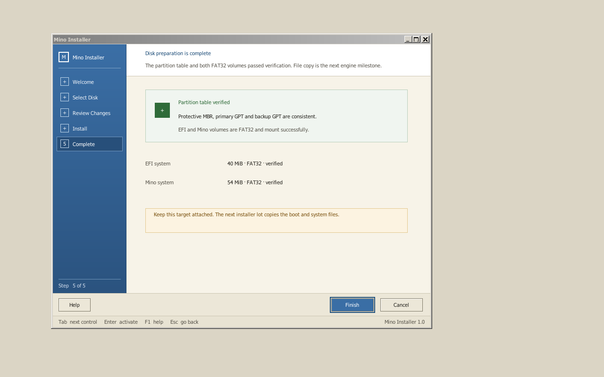
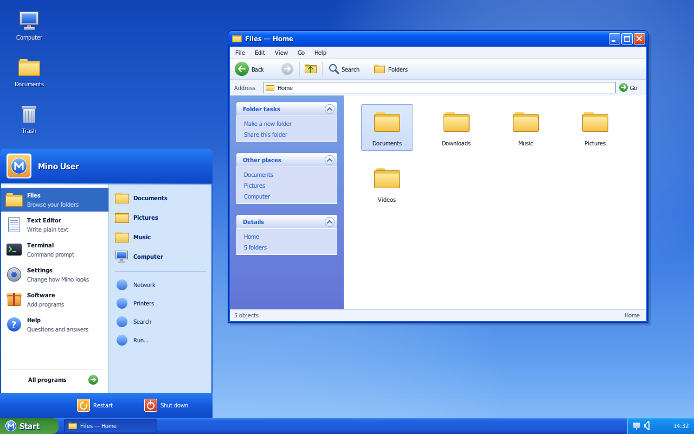

# Interface de l'installateur

État de l'interface native et de son moteur GPT initial, au-dessus du
constructeur d'image GPT/FAT décrit dans [`io-install.md`](io-install.md). Le
brief visuel reste
[`../design/installer-ui-prompt.md`](../design/installer-ui-prompt.md).



La présentation suit le thème bleu de Mino, dans le style de l'époque XP : un
écran d'installation plein écran (bandeaux bleu nuit, champ bleu en dégradé),
les cinq étapes et le disque cible à gauche, et l'assistant dans une fenêtre
à barre de titre bleue arrondie, avec en-tête blanc, cartes d'état et boutons
brillants. Tout est dessiné par le programme (`tests/native/theme.c`) : le
thème est original, il n'intègre aucune ressource Microsoft, et le texte est
la Tahoma de ReactOS épinglé.

## Architecture retenue

L'installateur est un programme Win32 natif, lié aux `user32`, `gdi32`,
`kernel32` et `ntdll` de ReactOS épinglé. Il utilise donc les fenêtres, GDI,
les polices, les files de messages et l'entrée de `win32k` ; il n'introduit
pas une seconde boîte à outils qui dessinerait directement dans le
framebuffer.

`tests/native/setup1.c` est la sonde exécutable de ce choix. Le scénario
`installer-ui` la met à la place de `winlogon.exe`, comme les autres bancs
d'essai de USER. Elle ouvre une fenêtre `WS_POPUP` de la taille de l'écran
(1280 × 800 sous QEMU) et dessine chaque image dans une DIB section de
32 bits sélectionnée dans un DC en mémoire : le programme écrit les formes
(dégradés, coins arrondis et disques anticrénelés par suréchantillonnage),
`win32k` écrit le texte (DrawText), puis un seul BitBlt copie l'image dans la
fenêtre. Le lot de GDI est vidé (GdiFlush) avant que le programme ne
retouche les pixels, pour garder l'ordre du peintre. C'est encore une sonde :
le programme définitif quittera `tests/native/` quand le chemin d'exécution
du moteur sera fixé.

## Choix avant installation

`BOOT1.EXE` est maintenant la commande initiale des images de développement.
Avant toute sélection de disque, il présente deux actions dans le même thème
bleu : **Install MinoOS** lance `SETUP1.EXE`, tandis que **Try MinoOS** lance
`DESKTOP1.EXE` depuis le média de démarrage, sans demander de disque cible et
sans appeler le moteur d'installation. Haut, Bas ou Tab changent le choix ;
Retour ou Espace l'active. L'installation reste le choix par défaut.

Le menu crée `WinSta0\\Default` une seule fois. Les deux programmes enfants
réutilisent cette station et ce bureau via leur `STARTUPINFO`, ce qui évite de
les enregistrer comme un second processus de logon. Le menu reste vivant et
caché pendant l'exécution du choix ; si l'enfant se termine, il réapparaît.

Les scénarios `boot-menu-install` et `boot-menu-live` vérifient les deux
chemins sur les profils AMD et Intel. Le premier s'arrête à l'accueil de
l'installateur ; le scénario `installer-ui` garde la responsabilité du test
destructif complet. Le second vérifie le bureau et ses pixels sans attacher de
disque cible.

## Aperçu et préparation GPT privilégiés

`NtDeviceIoControlFile`, avec `IOCTL_MINO_SETUP_QUERY`, donne à l'UI une
`abi::setup::SetupPreview` de 68 octets composée uniquement de mots 32 bits.
Elle contient la cible ATA, sa capacité, les deux plages de partitions et un
jeton stable calculé sur le plan. Cette première commande n'a aucun chemin
d'écriture.

`io_manager::install::Plan::guided` vérifie tout avant de rendre le plan :

- partitions alignées à 1 Mio et bornées par la plage GPT utilisable ;
- ESP FAT32 de 48 Mio (le chargeur, le noyau et le ramdisk du disque
  installé) et volume système FAT32 dans l'espace restant ;
- géométries acceptées par le même `fatfs::format` que le futur moteur ;
- média de démarrage primaire protégé ;
- disque qui porte `C:` protégé ;
- seul un maître secondaire présent, non monté et distinct du système peut
  porter le drapeau `SETUP_DISK_CANDIDATE`.

Le scénario `disk = target` crée un disque ATA secondaire vierge de 96 Mio.
L'UI ouvre la racine courante avec `FILE_READ_ATTRIBUTES`, demande l'aperçu
et affiche la capacité réelle. Pour ce disque, le plan rendu réserve 48 Mio
à l'ESP et 46 Mio au système. Sans cible sûre, Continuer reste bloqué.

L'action « Install » ouvre ensuite l'ancrage avec `FILE_WRITE_ATTRIBUTES` et
envoie un `SetupPrepare` de 16 octets à `IOCTL_MINO_SETUP_PREPARE`. Le noyau
re-sonde le maître secondaire, recalcule le plan depuis sa capacité, vérifie
qu'il ne porte toujours pas le système courant, puis compare le numéro et le
jeton. Le verrou du moteur refuse une commande concurrente ; une cible qui
porte déjà un MBR protecteur est également refusée.

Les GUID du disque et des deux partitions sont générés à partir du temps
système, du compteur de performance, du jeton et de domaines distincts. Le
moteur appelle ensuite `gpt::write`, qui écrit la table de secours avant la
principale, vide le cache ATA entre les copies, écrit le MBR protecteur et
vide de nouveau le cache. `gpt::read` relit enfin les deux copies et les
compare au plan exact avant de rendre le succès.

## Machine d'états

| Écran | Entrée | Action primaire | Retour permis |
|---|---|---|---|
| Accueil | aucune | choisir le disque | non |
| Disque | cible de développement unique | revoir les changements | Tab puis Retour, ou Échap |
| Revue | cible, suppression, GPT, ESP et système | commencer l'installation | Tab puis Retour, ou Échap |
| Installation | revalidation, deux GPT, formatage FAT32 et montage de contrôle | aucune pendant l'opération synchrone | non après la limite d'écriture |
| Terminé | GPT et deux volumes FAT32 vérifiés | terminer ce jalon | non |

Tab déplace le choix entre Retour et l'action primaire ; Retour ou Espace
l'active ; Échap revient en arrière tant qu'aucune écriture n'a commencé.
La fenêtre garde une position des actions constante, un focus visible, des
couleurs contrastées et les cinq étapes dans la colonne de gauche de l'écran.

## Limite de sécurité actuelle

La préparation écrit le MBR protecteur et les deux copies GPT, puis le lot de
formatage construit les deux volumes FAT32 bornés et vérifie qu'ils remontent
dans le lecteur du noyau. La copie du chargeur, du noyau et du système reste
le prochain lot. Un refus (`[setup] prepare failed: …` ou
`[setup] format failed: …`) laisse l'écran d'installation affiché et la
progression arrêtée. `SETUP1.EXE` ne reçoit aucun handle de disque brut ; le
noyau garde la sélection, la revalidation et les E/S ATA.

Ce jalon n'offre pas encore de démontage générique. Sa politique plus étroite
accepte seulement le maître secondaire présent que le démarrage n'a pas monté
comme `C:`, refuse toujours le média primaire et tient un verrou exclusif
pendant toute la préparation. Le constructeur `cargo xtask image` reste le
seul chemin qui crée une image complète et amorçable.

Le self-test noyau de la préparation est derrière la feature `test-install`
(scénarios `installer-prepare` et `persistence`) : les autres scénarios
gardent le disque cible vierge pour la préparation réelle de l'UI. Le
moteur tient en outre un **verrou exclusif** (`io_manager::install`) :
une seule préparation à la fois, `STATUS_DEVICE_BUSY` sinon. Chaque
marqueur `[setup] screen …` part **après** le paint de l'écran qu'il
nomme : le screendump du scénario ne prend plus une fenêtre à moitié
peinte (vu sur le chemin SYSENTER, où tout va plus vite).

Le scénario `installer-ui` injecte les touches par le moniteur de QEMU,
exerce Tab, Retour et Échap, franchit la limite d'écriture et vérifie des
pixels de l'écran final. Après chaque boot, l'hôte relit les CRC des deux GPT,
compare les deux partitions au plan 48 Mio/46 Mio, relit les deux volumes
FAT32 avec son propre lecteur et compare l'arbre copié au ramdisk, fichier
par fichier (`io-install.md`, lot 4 étape 2). Le scénario `installer-prepare`
vérifie en plus le mauvais jeton et la seconde préparation refusés sans
écriture. Les deux tournent avec les modèles de processeur AMD et Intel.

## Prototype du bureau

`DESKTOP1.EXE` est la première sonde du bureau assorti à l'installateur, dans
le même thème bleu (`theme.c`). Elle dessine un fond de ciel bleu en dégradé
avec les icônes Computer, Documents et Trash, une fenêtre Files (barre de
titre bleue, barre d'outils, adresse, volet de tâches bleu, dossiers), le menu
Démarrer ouvert en deux colonnes (en-tête bleu avec l'utilisateur, programmes
sur blanc, emplacements sur bleu clair, Restart et Shut down en bas) et la
barre des tâches bleue avec son bouton Start vert et sa zone de notification.
Le menu accepte Haut, Bas, Entrée, Espace et Échap. Le contenu de Files est
encore visuel : il ne parcourt pas le système de fichiers et ne remplace pas
encore un shell de production.



Le scénario `desktop-ui` vérifie les marqueurs après paint et trois zones de
couleur stables. Il tourne sur les mêmes profils CPU que l'installateur.

```bash
cargo xtask test --boot --scenario installer-ui --scenario desktop-ui
cargo xtask test --boot --scenario boot-menu-install --scenario boot-menu-live
```

## Suite

1. Copier le chargeur, le noyau et le système, puis rendre de vrais événements
   de progression ; la revue reste la dernière étape réversible.
2. Brancher Files sur le système de fichiers et déplacer le bureau hors des
   sondes natives vers le processus shell retenu.
3. Ajouter la souris PS/2, le ciblage par fenêtre, les messages `WM_MOUSE*`
   et le curseur dans `win32k`; la navigation clavier reste complète.
4. Ajouter le démontage générique, les erreurs récupérables, la reprise sûre
   et le redémarrage après vérification des fichiers copiés.

